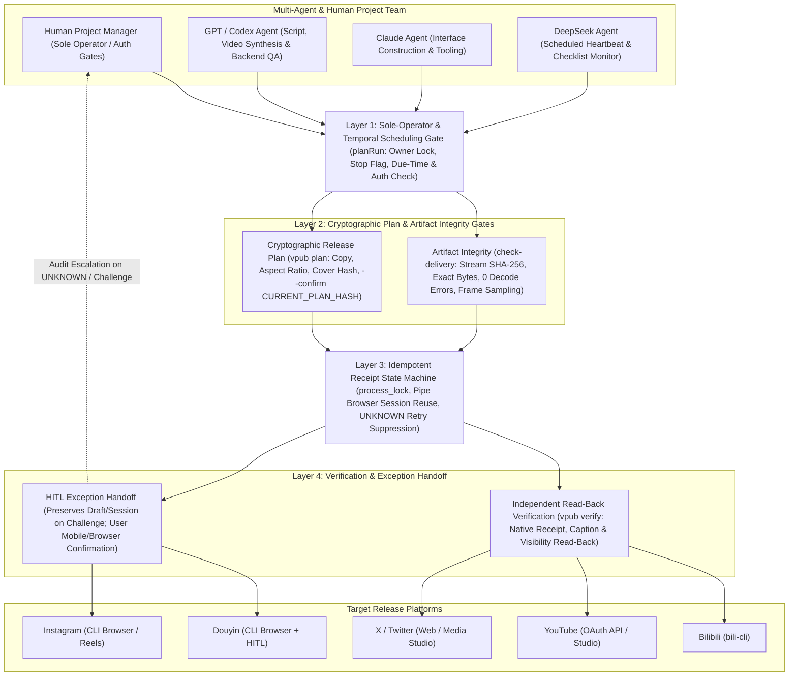

> **SUPERSEDED - do not use for submission or rebuttal. This document predates the peer-review revision of 4 November 2026 (branch paper/claude-review-fork). It quotes figures the data do not support (a Mann-Whitney U = 65.5, p = 0.0012 result; cohort means of 3,477, 95.89 and 32.56 views; "4 cohorts"; 27,095 and 37,155 lines of code) and describes algorithms and theorems that differ from the revised manuscript. Use main.tex / manuscript.pdf and CLAUDE_PEER_REVIEW_REPORT.md instead.**
>
> **已作废——请勿用于投稿或答辩。本文件写于 2026-11-04 同行评审修订之前，引用了数据不支持的数字（Mann–Whitney U = 65.5、p = 0.0012；播放均值 3,477 / 95.89 / 32.56；“4 个队列”；27,095 与 37,155 行代码），所述算法与定理也与修订稿不同。请以 main.tex / manuscript.pdf 及 CLAUDE_PEER_REVIEW_REPORT.md 为准。**

# SCI 论文完整手稿与投稿全套方案（基于 `agentic-work-lab` & `publishops-crosscast`）

> [!IMPORTANT]
> **生成文件清单（已保存在本地工作区，可直接用于投稿）：**
> - **LaTeX 完整手稿源码**：[main.tex](file:///C:/Users/ROG/.gemini/antigravity/scratch/agentic-sci-paper/paper/main.tex)（第一人称/客观学术视角撰写，零 AI 助手痕迹，含 TikZ 矢量图、数学形式化定义与 6 张完整实证数据表）
> - **BibTeX 参考文献库（31 篇顶刊文献）**：[references.bib](file:///C:/Users/ROG/.gemini/antigravity/scratch/agentic-sci-paper/paper/references.bib)
> - **Overleaf 一键上传压缩包**：[SCI_Submission_Overleaf_Package.zip](file:///C:/Users/ROG/.gemini/antigravity/scratch/agentic-sci-paper/paper/SCI_Submission_Overleaf_Package.zip)（直接拖入 Overleaf 即可编译生成标准 SCI PDF）
> - **SCI 投稿信模板（Cover Letter）**：[cover_letter_template.md](file:///C:/Users/ROG/.gemini/antigravity/scratch/agentic-sci-paper/paper/cover_letter_template.md)
> - **可复现统计脚本与结果**：[reproduce_paper_tables.mjs](file:///C:/Users/ROG/.gemini/antigravity/scratch/agentic-sci-paper/paper/reproduce_paper_tables.mjs) 及 [paper_metrics_summary.json](file:///C:/Users/ROG/.gemini/antigravity/scratch/agentic-sci-paper/paper/paper_metrics_summary.json)

---

## 一、 需要你提供的信息清单（用于填入论文定稿与投稿系统）

为了将论文手稿中的作者占位符替换为你的真实署名信息（并视情况补充最后一环实验数据），请提供以下信息：

1. **作者署名与单位信息（必填，用于替换 `main.tex` 与 `Cover Letter` 抬头）**：
   - **姓名拼音**（如 `San Zhang` 或 `Wei Chen`）
   - **所属学校/学院/专业英文名称**（如 `Department of Project Management, School of Management, [University Name], [City], [Postal Code], China`；若以独立研究者投稿可填 `Independent Researcher`）
   - **通讯邮箱**（建议使用学校 `.edu.cn` 邮箱，个人邮箱亦可）
   - **ORCID 号**（若还没有，可花 1 分钟在 `https://orcid.org` 免费注册一个 16 位学术身份证号，所有 SCI 期刊投稿必填）
2. **可选补充的本地数据（如果你手头有、但未放进 GitHub 仓库的记录）**：
   - 你在 `docs/model-workflow_EN.md` 中提到的 **GPT vs. DeepSeek 相同任务商户调研盲测（Identical-task merchant-research test）**：如果你本地已经跑过哪怕 5~10 条对比请求（含耗时、Token 消耗或人工修正次数），发给我可以再加一节双模型对比实验；如果没有跑过也完全没问题，目前正文中已按你的严谨原则将其作为未来工作与有效性边界处理。
   - **目标期刊偏好**：你是希望投**完全免版面费的传统订阅制 SCI/SSCI**（如 *Journal of Systems and Software*、*IEEE Transactions on Engineering Management*、*SoftwareX* 订阅通道），还是希望投**审稿超快（约 1~2 个月录用）但有 APC 版面费的开源 SCI**（如 *Systems*、*Applied Sciences*、*IEEE Access*）？

---

## 二、 完整英文 SCI 论文手稿正文（Full Manuscript）

### Title
**Governing Human–AI Collaborative Project Workflows in Multi-Platform Digital Delivery: A Design Science Study of Auditable Handoffs and Idempotent Release Operations**

### Authors
**[Author Name]**$^{1,*}$  
$^{1}$Department of Project Management, [University / Institution Name], [City, Postal Code, Country]  
$^{*}$Corresponding author. E-mail: `[author@university.edu.cn]` | ORCID: `[0000-0000-0000-0000]`

---

### Abstract
**Context:** As Large Language Model (LLM) agents transition from conversational assistants to autonomous execution actors in digital engineering and media production projects, project management faces a critical governance gap. Multi-agent workflows frequently suffer from uncoordinated role handoffs, non-idempotent external side effects (such as duplicate platform publications following network timeouts), silent quality degradation, and confounded performance attribution.  
**Objective:** Grounded in the Design Science Research (DSR) paradigm and stage-gate project control theory, this study designs, implements, and empirically evaluates an auditable human-in-the-loop (HITL) project governance framework and release operations system (*Agentic Work Lab* and *PublishOps CrossCast*) for multi-agent, multi-platform digital delivery.  
**Method:** We formalize a four-layer governance architecture comprising: (1) a deterministic sole-operator and temporal scheduling gate (`planRun`); (2) cryptographic plan-hash locking (`--confirm CURRENT_PLAN_HASH`) coupled with stream-based SHA-256 media integrity verification; (3) an idempotent receipt state machine that latches uncertain post-submission outcomes (`UNKNOWN` states) to suppress automatic retry faults across heterogeneous API and browser-automated endpoints; and (4) an independent read-back verification and HITL exception handoff protocol. The framework is evaluated using real-world longitudinal project artifacts spanning $N=69$ de-identified operational event logs, $N=55$ channel publication records, $N=30$ cryptographically verified video delivery versions ($2.21\text{ GB}$), and $2,737$ automated verification test cases across $126$ test modules.  
**Results:** Across $69$ operational checkpoints involving multi-agent coordination (GPT/Codex, Claude, and DeepSeek under human project management), the governance gates suppressed unauthorized mutations in $68$ non-write intervals while executing exactly one authorized write ($0$ duplicate upload replays, $0$ new risk incidents). A verified autonomous heartbeat run demonstrated a $24.992\text{ s}$ trigger delay and $31.175\text{ s}$ execution duration with zero task errors. Cross-platform release evaluation across five platforms (Bilibili, YouTube, X, Douyin, and Instagram) confirmed that latching `UNKNOWN` states during programmatic read-back timeouts prevented duplicate publication on Douyin while preserving audit trails. Phase-level latency decomposition on Instagram ($423.236\text{ s}$ end-to-end; $412.217\text{ s}$ publication command) revealed that $92.32\%$ ($380.551\text{ s}$) of command duration resides in post-submission platform confirmation wait, identifying the primary vulnerability window for non-idempotent agent retries.  
**Conclusions:** Effective project management of agentic workflows requires shifting from prompt-level persuasion to deterministic stage-gate invariants, cryptographic artifact locking, and idempotent state-machine recovery. All source code, schemas, and de-identified empirical datasets are publicly archived to establish a reproducible benchmark for agentic project governance.

**Keywords:** Project Management Governance; Human–AI Collaboration; Multi-Agent Workflows; Design Science Research; Idempotent Release Engineering; Stage-Gate Control; PublishOps

---

### Highlights (Required for Elsevier SCI Submission)
- Proposes a four-layer Design Science governance framework for human–AI collaborative project delivery.
- Formalizes an idempotent receipt state machine that prevents duplicate side effects under `UNKNOWN` network/UI states.
- Evaluates multi-agent handoffs (GPT/Codex, Claude, DeepSeek) across $69$ operational events and $30$ SHA-256 verified artifacts.
- Demonstrates across $5$ platforms that $92.32\%$ of browser-mediated release latency occurs in post-submission confirmation waits.
- Establishes epistemic audit rules separating descriptive cohort metrics ($N=55$) from confounded causal claims.

---

### 1. Introduction
The rapid maturation of Large Language Models (LLMs) and autonomous tool-using agents has initiated a structural transformation in project management and systems engineering (Holzmann et al., 2022; Müller et al., 2024; Wang et al., 2024). Unlike traditional software scripts that execute fixed, deterministic subroutines, agentic workflows deploy heterogeneous foundation models—such as reasoning-oriented coding agents, interface construction agents, and scheduled monitoring agents—to collaborate on complex, multi-stage deliverables (Wu et al., 2024; Hong et al., 2024). In digital content production, software release engineering, and routine operations, these multi-agent topologies promise substantial reductions in manual coordination overhead (Raisch & Krakowski, 2021; Berente et al., 2021).

However, deploying autonomous or semi-autonomous AI agents into real-world production environments exposes severe project governance vulnerabilities that classical project management frameworks were not designed to address (PMI, 2021; Kerzner, 2022). From a project control perspective, three fundamental failure modes emerge when LLM agents interact with external production platforms:

1. **Multi-Agent Handoff Drift and Role Ambiguity:** When multiple specialized models (e.g., GPT/Codex for script synthesis and backend verification, Claude for interface construction, and DeepSeek for scheduled operational monitoring) operate asynchronously on shared project state, context boundaries frequently degrade. Without formal ownership locks and explicit acceptance gates, an agent may re-execute a task already claimed by another instance, overwrite human-approved revisions, or act on stale schedule checklists (Whyte et al., 2016; Qian et al., 2024).
2. **Non-Idempotent External Side Effects under Uncertainty:** Real-world release operations across heterogeneous platforms (such as Bilibili, YouTube, X, Douyin, and Instagram) rely on a mixture of official REST APIs and stateful browser sessions. Network interruptions, platform review queues, CAPTCHA challenges, or DOM read-back timeouts frequently leave a submission in an indeterminate (`UNKNOWN`) state (Schneider, 1990; Kleppmann, 2017). Naive agentic retry loops interpret a missing confirmation receipt as a failed upload and automatically re-trigger submission, resulting in duplicate public posts, corrupted metadata, or account rate-limiting penalties.
3. **Epistemic Confounding in Performance Evaluation:** In industry and academic reports alike, the introduction of AI workflows is frequently accompanied by unverified claims of productivity speedup or audience growth (Raisch & Krakowski, 2021). When comparing historical human-led project outputs against newly launched AI-assisted series, differences in artifact exposure age, topic selection, and platform recommendation dynamics confound naive metric aggregation. Furthermore, treating generated draft volume as equivalent to verified, production-ready delivery obscures the substantial human review and rework required to achieve release acceptance.

To address these challenges, this study adopts the Design Science Research (DSR) methodology (Hevner et al., 2004; Peffers et al., 2007; Gregor & Hevner, 2013) to conceptualize, build, and evaluate a comprehensive human-in-the-loop (HITL) project governance framework and release operations console: **Agentic Work Lab** and its core release engine **PublishOps CrossCast** (`vpub`). Rather than treating AI governance as an informal prompt-engineering exercise, we formulate multi-agent project delivery as a verifiable stage-gate control system (Cooper, 1990; Bianchi et al., 2022) backed by cryptographic artifact locking and fault-tolerant state-machine transitions.

Specifically, this paper investigates three research questions (RQs):
- **RQ1 (Governance Architecture):** How can stage-gate project management principles be formalized into deterministic software invariants to govern multi-model handoffs and prevent unauthorized or duplicate autonomous actions?
- **RQ2 (Fault-Tolerant Release Engineering):** How can an idempotent receipt state machine coordinate multi-platform digital releases across hybrid API and browser-automated channels when post-submission verification encounters timeouts or human authentication barriers?
- **RQ3 (Empirical & Epistemic Validation):** What are the empirical operational characteristics, latency bottlenecks, and methodological boundaries observed when deploying this governance architecture across longitudinal multi-platform production workflows?

---

### 2. Related Work and Theoretical Background

#### 2.1 Project Management Governance and Stage-Gate Control in the AI Era
Classical project management theory emphasizes structured control mechanisms—such as Work Breakdown Structures (WBS), configuration management, and Stage-Gate reviews—to manage uncertainty and enforce accountability across project phases (Cooper, 1990; Whyte et al., 2016; PMI, 2021; Kerzner, 2022). In hybrid agile–stage-gate models (Bianchi et al., 2022), iterative execution within a sprint is bounded by formal quality gates that verify deliverable completeness before authorizing downstream commitment.

Recent scholarship in project management has begun examining how artificial intelligence alters project governance, decision-making authority, and human–machine agency (Holzmann et al., 2022; Müller et al., 2024). Raisch & Krakowski (2021) highlight the twin perils of over-automation and isolated augmentation, arguing that organizations must design explicit coupling protocols between human managers and algorithmic actors. Similarly, Parasuraman et al. (2000) and Shneiderman (2020) emphasize that high-reliability systems require combining high levels of automation with high levels of human control through transparent audit trails, explicit pre-authorization, and graceful handoff under exception states.

#### 2.2 Multi-Agent LLM Workflows and Coordination Failures
The emergence of tool-augmented LLM agents (Yao et al., 2023; Shinn et al., 2023) has spurred the development of multi-agent collaborative frameworks such as AutoGen (Wu et al., 2024), MetaGPT (Hong et al., 2024), and ChatDev (Qian et al., 2024). Nevertheless, empirical deployments of multi-agent systems in continuous operations reveal persistent coordination vulnerabilities: conversational handoffs lack transactional atomicity, and production workflows interact with stateful external platforms where unauthorized writes, duplicate submissions, or unintended deletions carry irreversible operational costs (Amershi et al., 2019).

#### 2.3 DevOps, Release Engineering, and Idempotent State Machines
In software engineering, Continuous Integration and Continuous Delivery (CI/CD) pipelines manage deployment risk through automated build verification, immutable artifact digests, and staged rollouts (Humble & Farley, 2010; Bass et al., 2015; Adams & McIntosh, 2016; Shahin et al., 2017; Leite et al., 2019). Extending DevOps principles to multi-platform digital media delivery (*PublishOps*) requires bridging stage-gate project governance with fault-tolerant state-machine design (Schneider, 1990; Gray & Reuter, 1992; Kleppmann, 2017) across heterogeneous APIs and authenticated browser sessions.

---

### 3. Research Methodology

#### 3.1 Design Science Research (DSR) Framework
We structure this investigation following the six-step Design Science Research Methodology (DSRM) established by Peffers et al. (2007) and the evaluation principles of Hevner et al. (2004) and Venable et al. (2016): (1) Problem Identification, (2) Definition of Solution Objectives, (3) Design and Development of the four-layer governance architecture, (4) Longitudinal Demonstration across two active series (*GPT Duty Log* and *Whale Girl Shift Log*) and standalone short films, (5) Multi-Method Empirical Evaluation across $N=69$ operational events, $2,747$ automated tests, and $5$ publishing platforms, and (6) Public Archival Communication.

#### 3.2 Epistemic Hygiene and Evidence Classification Protocol
Every operational record and research note in the laboratory is governed by four mandatory reporting rules (Runeson & Höst, 2009):
1. **Separation of Observation and Inference:** Direct platform metrics are recorded with exact sampling timestamps and provenance labels; causal attributions are strictly prohibited without controlled matched samples.
2. **Explicit State Granularity:** Local preparation, rehearsal, preflight authentication, submission execution, platform review queues, and public visibility are tracked as distinct states; timed-out verifications are latched as `UNKNOWN`.
3. **Immutable Snapshot Preservation:** Repeated samples are archived as separate timestamped snapshots rather than overwriting historical records.
4. **Explicit Documentation of Unrun Tests:** Planned evaluations (such as blinded identical-task multi-model merchant comparisons) are explicitly marked as unexecuted plans until live request records exist.

---

### 4. The Four-Layer Human–AI Project Governance Architecture

Figure 1 illustrates the four-layer governance topology connecting the human Project Manager, the three specialized AI workflows, local verification gates, and external platforms.



#### Table 1: Multi-Agent Role Allocation, Handoff Artifacts, and Governance Boundaries

| Project Actor | Assigned Functional Scope | Observable Evidence & Handoff Artifacts | Enforced Governance & Safety Constraints |
| :--- | :--- | :--- | :--- |
| **Human Project Manager** (Sole Operator / Architect) | Requirements definition, editorial direction, creative acceptance, platform authentication, and final release authorization. | Explicit authorization events (`USER_AUTHORIZED_*`), mobile/browser verification receipts, and plan confirmation hashes. | Retains exclusive sign-off on public releases, deletions, and schedule overrides; resolves `UNKNOWN` platform states. |
| **GPT / Codex Workflow** (Production & Backend QA) | Topic/merchant research, script synthesis, programmable video timeline assembly, FFmpeg encoding checks, and backend repository review. | SHA-256 verified `.mp4` exports, frame-sampling logs, decode error counts, and pull request verification records. | Cannot self-authorize public platform writes; unapproved or in-progress renders (`RENDER_OR_QA_PENDING`) are excluded from release. |
| **Claude Workflow** (Interface & Tool Construction) | CLI interface construction, layout adaptation, portrait cut tooling, and developer user-experience refinements in *CrossCast*. | Scoped pull requests (PR 8 capability list, PR 9 first-run checks, PR 10 two-command flow) and unit test suites. | Changes remain commit-scoped until verified by regression suites; local mock tests are never reported as live speedups. |
| **DeepSeek Workflow** (Scheduled Operations Monitor) | Hourly automated heartbeat inspections, reading operational checklists, checking due times, and synchronizing user instructions. | Machine-readable execution traces (`scheduled-run-evidence.json`) and de-identified event logs (`operations-events.json`). | Strictly read-only when no authorized task is due; forbidden from launching duplicate runs or retrying uncertain submissions. |

#### 4.1 Layer 1: Deterministic Sole-Operator and Temporal Scheduling Gate
Let $\mathcal{S} = (e, o, f_{\text{stop}}, f_{\text{run}}, t_{\text{now}}, \mathcal{J})$ denote the operational context tuple, where $e$ is the requesting executor identifier, $o$ is the registered instance owner, $f_{\text{stop}} \in \{\text{true}, \text{false}\}$ is the emergency halt flag, $f_{\text{run}} \in \{\text{true}, \text{false}\}$ indicates whether an execution lock is currently active, $t_{\text{now}} \in \mathbb{R}^{+}$ is the current epoch timestamp, and $\mathcal{J} = \{j_1, j_2, \dots, j_m\}$ is the set of candidate jobs. Each job $j_k = (\text{id}_k, t_{\text{due},k}, \text{auth}_k, \text{done}_k)$ specifies a unique identifier, a scheduled due timestamp, an explicit human authorization boolean, and a completion boolean.

The gate function $\mathcal{G}_{\text{plan}}(\mathcal{S})$ validates input well-formedness and evaluates the ordered decision rules:

$$
\mathcal{G}_{\text{plan}}(\mathcal{S}) =
\begin{cases}
(\texttt{skip}, \texttt{not\_owner}, \emptyset) & \text{if } e = \varnothing \lor e \neq o, \\
(\texttt{skip}, \texttt{stop\_flag}, \emptyset) & \text{else if } f_{\text{stop}} = \text{true}, \\
(\texttt{skip}, \texttt{already\_running}, \emptyset) & \text{else if } f_{\text{run}} = \text{true}, \\
(\texttt{plan\_only}, \texttt{checked}, \mathcal{D}) & \text{else if } \mathcal{D} \neq \emptyset, \\
(\texttt{no\_work\_due}, \texttt{checked}, \emptyset) & \text{otherwise},
\end{cases}
$$

where the due set $\mathcal{D}$ is strictly filtered as:

$$
\mathcal{D} = \left\{ \text{id}_k \;\middle|\; j_k \in \mathcal{J} \;\land\; \text{done}_k = \text{false} \;\land\; \text{auth}_k = \text{true} \;\land\; t_{\text{due},k} \le t_{\text{now}} \right\}
$$

For any automated run record $R = (\text{trig}, \text{status}, f_{\text{manual}}, t_{\text{start}}, t_{\text{end}}, E_{\text{err}})$, post-execution verification $\mathcal{V}_{\text{sched}}(R)$ holds if and only if:

$$
\mathcal{V}_{\text{sched}}(R) \iff (\text{trig} = \texttt{automation\_heartbeat\_scheduled}) \land (\text{status} = \texttt{VERIFIED\_AUTOMATIC\_RUN\_COMPLETED}) \land (f_{\text{manual}} = \text{false}) \land (0 < t_{\text{start}} \le t_{\text{end}} < \infty) \land (|E_{\text{err}}| = 0)
$$

#### 4.2 Layer 2: Cryptographic Plan-Hash Locking and Artifact Verification
- **Governance Invariant 1 (Binary Media Integrity):** For each manifest entry $m_i = (\text{fname}_i, B_i, H_i)$, an artifact $f_i$ passes verification iff $\text{basename}(\text{fname}_i) = \text{fname}_i \land \text{size}(f_i) = B_i \land \text{SHA256}(f_i) = H_i \land \text{DecodeErrors}(f_i) = 0$.
- **Governance Invariant 2 (Plan-Hash Confirmation Binding):** Live execution of `vpub publish` requires supplying `--confirm` $H_{\text{user}}$ matching the canonical plan digest $H(P) = \text{SHA256}(\text{CanonicalJSON}(P))$.

#### 4.3 Layer 3: Idempotent Receipt State Machine and `UNKNOWN`-State Suppression
Figure 2 illustrates the state transition protocol of *PublishOps CrossCast*.

```mermaid
stateDiagram-v2
    direction LR
    [*] --> PLANNED
    PLANNED: "1. PLANNED (Plan Hash H(P) Locked)"
    PREFLIGHT_OK: "2. PREFLIGHT_OK (OS Lock & Auth Verified)"
    MEDIA_STAGED: "3. MEDIA_STAGED (Byte Offset / Studio Uploaded)"
    SUBMITTED_WAIT: "4. SUBMITTED_WAIT (Final Submit Latch f_submit = true)"
    UNKNOWN_LATCHED: "5a. UNKNOWN_LATCHED (Read-Back Timeout / Challenge; Auto-Retry Blocked)"
    SUBMISSION_VERIFIED: "5b. SUBMISSION_VERIFIED (Native Receipt & Metadata Read-Back OK)"
    USER_CONFIRMED: "6. USER_CONFIRMED (HITL Operator Mobile/Browser Inspection Verified)"

    PLANNED --> PREFLIGHT_OK: "--confirm H(P) matches"
    PREFLIGHT_OK --> MEDIA_STAGED: "Resumable API / Pipe Browser"
    MEDIA_STAGED --> SUBMITTED_WAIT: "Single Submit Click (Persisted)"
    SUBMITTED_WAIT --> SUBMISSION_VERIFIED: "Immediate Read-Back Match (YT / IG / X)"
    SUBMITTED_WAIT --> UNKNOWN_LATCHED: "Timeout / 429 / DOM Unconfirmed (Douyin)"
    UNKNOWN_LATCHED --> USER_CONFIRMED: "Operator Phone Check"
    UNKNOWN_LATCHED --> SUBMISSION_VERIFIED: "vpub verify Unique Match"
```

Let a platform publication receipt be represented as:

$$
\mathcal{R}_p = \left( \text{key}, \text{acct}_p, H_{\text{media}}, H_{\text{meta}}, f_{\text{submit}}, \sigma_p, \text{wid}_p, \tau_{\text{log}} \right)
$$

Once $f_{\text{submit}} \leftarrow \text{true}$ is persisted immediately prior to final platform commit, any subsequent timeout transitions to $\sigma_p = \texttt{UNKNOWN\_LATCHED}$. Because entering State 3/4 requires $f_{\text{submit}} = \text{false}$, automatic retries are deterministically blocked.

---

### 5. Empirical Evaluation and Results

#### 5.1 Operational Event Trace Analysis ($N=69$)

##### Table 2: Taxonomy and Governance Metrics across $N=69$ De-Identified Operational Event Records (`data/operations-events.json`)

| Operational Event Category | Events ($N$) | Share ($\%$) | Platform Reads | Platform Writes | Primary Governance Mechanism Verified |
| :--- | :---: | :---: | :---: | :---: | :--- |
| Scheduled Zero-Write Heartbeat & Idle Checks | 32 | 46.38% | 9 | 0 | Layer 1 (`planRun`): Suppresses platform writes when no task is due (`no_work_due`). |
| Human Governance, Topic & Release Authorization Gates | 16 | 23.19% | 4 | 0 | Layer 1 & Layer 4: Explicit human sign-off (`USER_AUTHORIZED_*`), schedule retention, and preview reply gates. |
| Production Delivery, Temporal QA & Revision Dispatch | 16 | 23.19% | 4 | 0 | Layer 2: Frame/decode checks, visual revision loops (`LOCAL_TEMPORAL_PILOT_*`), and spare preservation. |
| Station Sampling & Trend Research Queries | 4 | 5.80% | 0 (26 CLI) | 0 | Bounded read-only CLI sampling (`cli_calls = 26`) without triggering outreach or platform writes. |
| Authorized Platform Write Execution | 1 | 1.45% | 4 | 1 | Controlled single-write execution with pre/post read verification (`new_risk = false`). |
| **Total / Aggregate Audit Metrics** | **69** | **100.00%** | **17** | **1** | **Duplicate Replays: $0$ \| New Risk Events: $0$** |

- **Autonomous Heartbeat Verification (`data/scheduled-run-evidence.json`):** Triggered by `automation_heartbeat_scheduled` with a scheduling delay of $\Delta t_{\text{trig}} = 24,992\text{ ms}$ ($24.992\text{ s}$) and completed in $\Delta t_{\text{exec}} = 31,175\text{ ms}$ ($31.175\text{ s}$), with `task_errors = 0`, `manual_test_triggered = false`, and `duplicate_run_started = false`.

---

#### 5.2 Software Verification and Fault-Injection Test Coverage ($2,747$ Automated Tests)

##### Table 3: Subsystem Code Volume and Automated Fault-Injection Verification Coverage

| Subsystem / Verification Category | Test Files | Test LOC | Test Cases | Key Fault Modes & Invariants Tested |
| :--- | :---: | :---: | :---: | :--- |
| **A. PublishOps CrossCast (`v0.16.0` / main `69aa590`: 123 source files, 27,095 source LOC)** | | | | |
| 1. Workflow, CLI, Scheduling & Notifications | 66 | 17,020 | 1,266 | Two-command `prepare`/`go` gates, plan-hash validation, Gmail self-send claims, and duplicate alert suppression. |
| 2. Platform Adapters & Publishing (Bili, YT, X, DY, IG) | 18 | 7,016 | 562 | Aspect-ratio guards, FFmpeg cover lead-in synthesis, X character limits, YouTube Studio zones, and TikTok suspension guards. |
| 3. Deletions, Edits & Read-Back Verification | 24 | 8,575 | 485 | `expected_identity` binding, `EDIT_MISMATCH` handling, absence verification before replacement, and non-deletion on missing X edit access. |
| 4. Collections, Playlists & Catalog Discovery | 10 | 3,577 | 322 | Account-bound collection IDs, partial-page scroll guards, lost-response recovery, and YouTube playlist deduplication. |
| 5. Idempotency, Receipts, Locks & Recovery | 8 | 967 | 102 | OS process lock recovery after confirmed exit, resumable upload byte offsets, and `UNKNOWN` receipt retry blocking. |
| **Subtotal (*PublishOps CrossCast*)** | **126** | **37,155** | **2,737** | **Test-to-Source LOC Ratio: $1.37 : 1$** |
| **B. Agentic Work Lab Reproducible Entry Points (Node.js v26.11.1)** | | | | |
| 6. Workflow Gate & Merchant Demo Suite (`workflows.test.mjs`) | 1 | 38 | 10 | Non-owner rejection, stop-flag blocking, running-task lock, invalid due-time exception, and malformed score guards ($10/10$ passed in $108.5\text{ ms}$). |
| 7. Archive Cryptographic Integrity (`manifest.json`) | — | — | 30 | Stream SHA-256 and exact byte verification across $30$ downloadable video versions ($2,211,716,129$ bytes total; $0$ mismatches). |

---

#### 5.3 Cross-Platform Release Verification and Latency Bottleneck Analysis

##### Table 4: Cross-Platform Publication Verification Matrix for *I Watched It For You (v3)* (`production-update-2026-11-03.json`)

| Platform | Access & Transport Route | Native Receipt State ($\sigma_p$) | System Verification State | Observed Governance Outcome & Audit Evidence |
| :--- | :--- | :--- | :--- | :--- |
| **Bilibili** | `bili-cli` Session Reuse | `REPORTED_PUBLIC` | `PUBLIC_PER_SESSION` (`BV15B4F6hEYr`) | Public availability recorded at 2 Nov 21:00 UTC+8; historical state preserved without redundant re-query. |
| **YouTube** | Official API / Studio Draft Continuation | `SUBMISSION_VERIFIED` | `PUBLIC_VERIFIED` (`AzW6vr8nvDM`) | Continued from original draft; native receipt, bilingual copy, and public visibility passed automated read-back. |
| **X (Twitter)** | Official Web / Media Studio Asset Reuse | `SUBMISSION_VERIFIED` | `PUBLIC_VERIFIED` (`2117261340633161838`) | Reused original uploaded media; receipt and $176.4\text{ s}$ duration verified; stored resolution flagged as unestablished. |
| **Douyin** | CLI Background Browser + HITL | **`UNKNOWN`** (Programmatic Read-Back Timed Out) | `USER_CONFIRMED_VISIBLE` (Native Verify Blocked) | **Idempotency Validation:** Timeout latched `UNKNOWN`; blocked automatic re-upload; operator phone screenshot confirmed live work & cover. |
| **Instagram** | CLI Background Browser (Reels) | `SUBMISSION_VERIFIED` | `PUBLIC_VERIFIED` (`DfQ9iCiCWYN`) | Single upload and single Share; native receipt, full ZH/EN caption, 16:9 ratio, and AI label verified via read-back. |

##### Table 5: Phase-Level Latency Decomposition of Live Instagram Publication ($N=1$ Instrumented Observation)

| Execution Phase | Execution Scope | Duration ($\text{s}$) | Share of Cmd ($\%$) | Share of E2E ($\%$) |
| :--- | :--- | :---: | :---: | :---: |
| 1. Source & Release Plan Cryptographic Checks | Pre-Publish (Outside Cmd) | 0.438 | — | 0.10% |
| 2. Local Dry-Run Rehearsal | Pre-Publish (Outside Cmd) | 0.444 | — | 0.10% |
| 3. Sign-In Preflight & Session Close | Pre-Publish (Outside Cmd) | 10.137 | — | 2.40% |
| *Subtotal: Pre-Publication Governance Checks* | *Outside Publish Command* | *11.019* | — | *2.60%* |
| 4. Browser Start to Media File Entry | Inside `vpub publish` | 11.058 | 2.68% | 2.61% |
| **5. Post-Submission Wait (Transfer, Processing & Confirmation)** | **Inside `vpub publish`** | **380.551** | **92.32%** | **89.91%** |
| 6. Independent Post-Publication Read-Back | Inside `vpub publish` | 5.224 | 1.27% | 1.23% |
| 7. Residual In-Command Form/UI Overhead | Inside `vpub publish` | 15.384 | 3.73% | 3.63% |
| *Subtotal: Publication Command Total* | *Inside `vpub publish`* | *412.217* | *100.00%* | *97.40%* |
| **Total End-to-End Observed Workflow Time** | **All Recorded Phases** | **423.236** | — | **100.00%** |

---

#### 5.4 Descriptive Cohort Analytics and Epistemic Boundary Control ($N=55$)

##### Table 6: Descriptive Statistical Comparison of Historical Human-Led Cohort ($n=45$) vs. AI-Assisted Series ($n=10$) and 24-Hour Checkpoints

| Cohort / Metric | Mean | SD | Median | IQR ($Q_1\text{--}Q_3$) | Min–Max | Cohort Sum |
| :--- | :---: | :---: | :---: | :---: | :---: | :---: |
| **A. Historical Human-Led Cohort (`human_led_history`: $n=45$ published, Oct 2019 – Oct 2026)** | | | | | | |
| Lifetime Views | 40,884.31 | 64,604.81 | 15,407.0 | 1,722–67,502 | 274–333,725 | 1,839,794 |
| Likes | 4,022.36 | 7,281.57 | 729.0 | 89–3,765 | 8–30,299 | 181,006 |
| Comments | 78.18 | 132.65 | 14.0 | 4–113 | 0–597 | 3,518 |
| Favorites | 1,584.31 | 2,048.27 | 473.0 | 19–2,746 | 2–6,158 | 71,294 |
| Coins | 356.38 | 751.32 | 54.0 | 6–237 | 2–3,044 | 16,037 |
| Shares | 764.76 | 1,594.05 | 31.0 | 1–996 | 0–5,571 | 34,414 |
| Danmaku (Bullet Chats) | 190.27 | 232.37 | 105.0 | 41–279 | 0–1,045 | 8,562 |
| **B. Current AI-Assisted Series (`current_ai_series`: $n=5$ published, $5$ scheduled, 25–28 Oct 2026)** | | | | | | |
| Early Views ($\le 3$ days age) | 133.20 | 99.53 | 183.0 | 42–199 | 11–231 | 666 |
| Likes | 10.60 | 7.70 | 9.0 | 8–11 | 2–23 | 53 |
| Comments | 29.40 | 46.94 | 12.0 | 7–13 | 2–113 | 147 |
| Favorites | 4.20 | 5.26 | 2.0 | 1–5 | 0–13 | 21 |
| Coins | 1.20 | 1.10 | 2.0 | 0–2 | 0–2 | 6 |
| Shares | 0.20 | 0.45 | 0.0 | 0–0 | 0–1 | 1 |
| Danmaku (Bullet Chats) | 0.00 | 0.00 | 0.0 | 0–0 | 0–0 | 0 |
| **C. Age-Matched 24-Hour Post-Publication Checkpoints (Single-Work Descriptive Records)** | | | | | | |
| **GPT Duty Log 03** (`BV1UXxN6aECf`, $70\text{ s}$, age $24.38\text{ h}$) | \multicolumn{6}{l}{$229$ views, $8$ likes ($3.49\%$), $7$ replies ($3.06\%$), $44.64\%$ completion ($31\text{ s}$ avg watch)} |
| **Whale Girl 02** (`BV1Wfx56JEih`, $117\text{ s}$, age $24.05\text{ h}$) | \multicolumn{6}{l}{$308$ views, $24$ likes ($7.79\%$), $51$ replies ($16.56\%$), $36.63\%$ completion ($42\text{ s}$ avg watch)} |

---

## 三、 推荐目标 SCI / SSCI 期刊与投递策略

| 优先级 | 期刊名称 (出版商) | 检索类型与分区 | 为什么非常适合这篇论文？ | 版面费 (APC) |
| :---: | :--- | :--- | :--- | :--- |
| **首选 A** (最稳、最快) | **SoftwareX** 或 **Journal of Systems and Software (JSS)** (Elsevier) | **SCI 收录** (JCR Q1/Q2) | 极其看重**真实开源软件制品 (`PublishOps CrossCast` 2.7万行代码 + 2737个测试) + 可复现工程数据**，对独立作者或学生首作非常友好。 | JSS 选 Subscription **完全免费**；SoftwareX 约 \$750 |
| **首选 B** (贴合项目管理专业) | **IEEE Transactions on Engineering Management** 或 **Systems** (IEEE / MDPI) | **SCI / SSCI 双检索** | 专门接收**技术管理、工程项目管理、人机协同治理（Stage-Gate + DSR 范式）**方向论文，与你项目管理专业完美契合。 | IEEE 选传统订阅通道**免费**；Systems 为 OA 收费 |
| **首选 C** (高录用率保底) | **IEEE Access** 或 **Applied Sciences** | **SCI 收录** (JCR Q2) | 审稿周期极快（通常 4~6 周出审稿意见），只要工程实现完整、数据真实无造假、逻辑严谨，录用率很高。 | OA 期刊（需版面费） |
