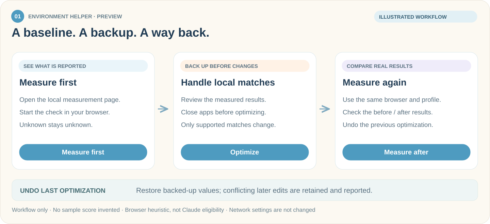
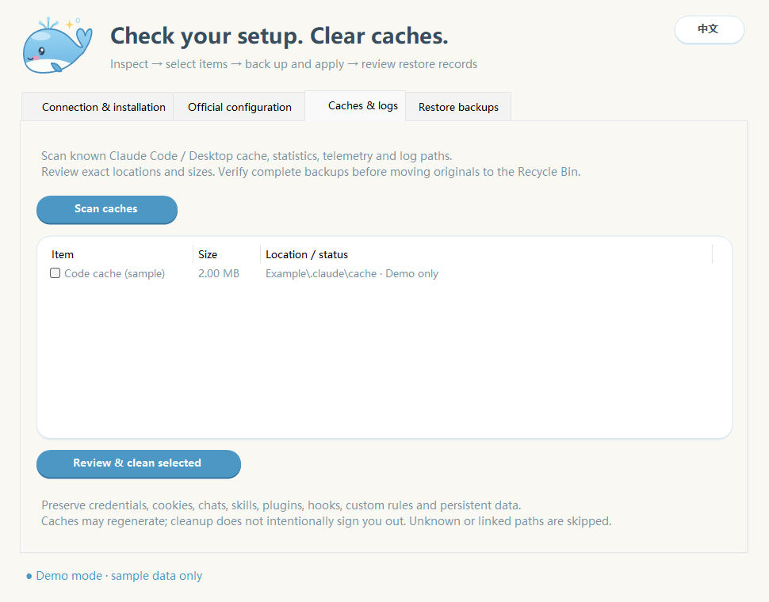
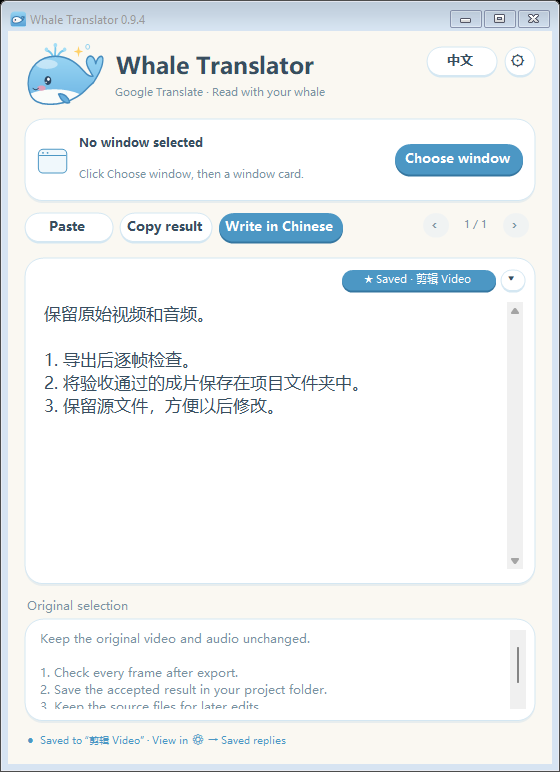
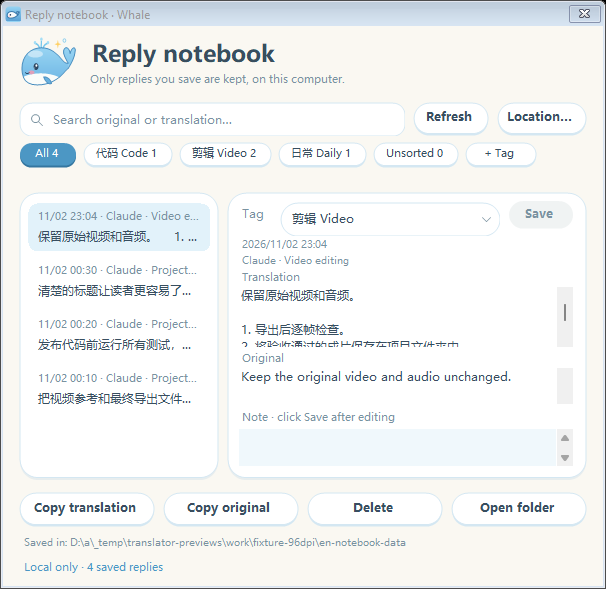
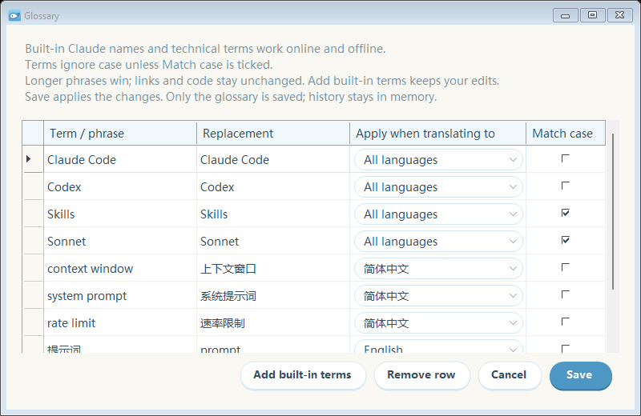
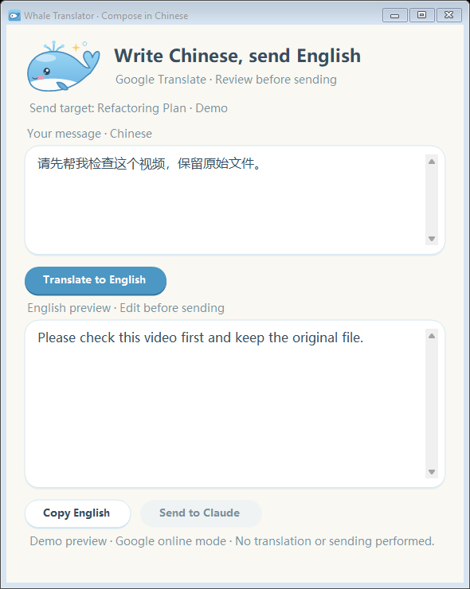
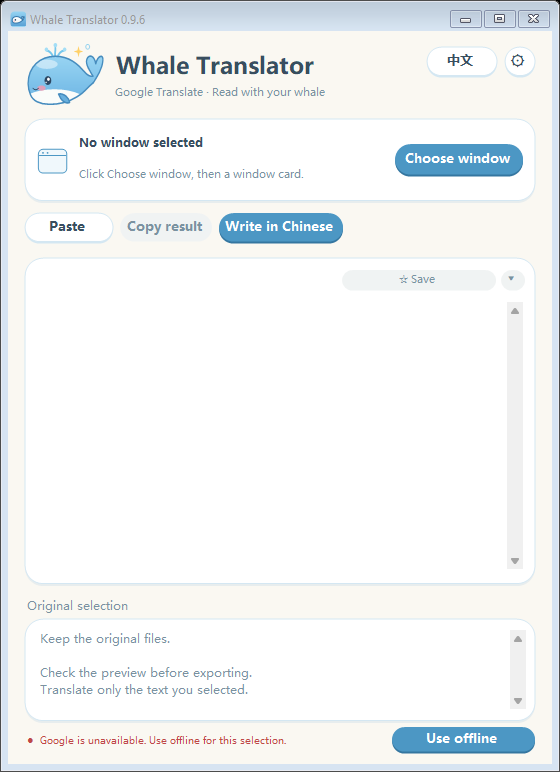
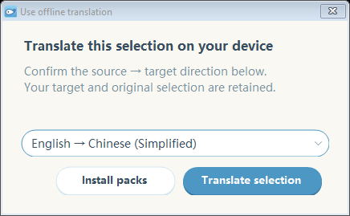
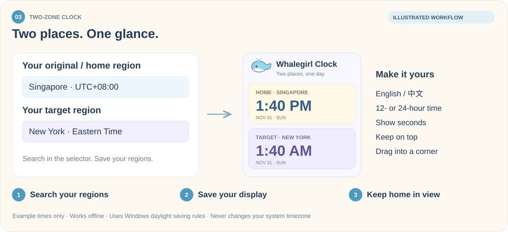
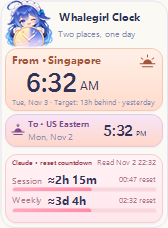

<p align="center">
  
</p>

<h1 align="center">I Must Use Claude</h1>
<p align="center"><strong>Understand your local setup. Read Claude comfortably. Keep your home time in view.</strong></p>
<p align="center">我一定要用上Claude · Four whale-themed Windows companions, built around using Claude.</p>

<p align="center">
  
  
  
  
</p>

<p align="center"><a href="README.md">繁體中文</a> · <strong>English</strong> · <a href="../../README_EN.md">Back to Agentic Work Lab</a></p>
<p align="center">
  <a href="https://github.com/whitecarp/I-Must-Use-Claude/releases/tag/v0.4.5-preview"><strong>↓ Download the apps</strong></a>
  &nbsp; · &nbsp; <a href="https://whitecarp.github.io/I-Must-Use-Claude/">Project page</a>
  &nbsp; · &nbsp; <a href="#choose-your-companion">Explore the tools</a>
  &nbsp; · &nbsp; <a href="docs/BUILDING.md">Build from source</a>
</p>

---

## Core Positioning: Purpose, Problems Solved & Target Audience

### 1. Core Purpose (What It Does)
**I Must Use Claude (WhaleGirl Desktop Toolbox)** is an all-in-one Windows desktop utility suite built for cross-timezone collaboration, real-time bilingual communication with Claude, multi-file context packaging, and reversible local environment diagnostics. It ships four standalone native utilities:
1. **Whale Environment Helper (`apps/whale-claude-helper/`)**: Reversible browser-signal and network/DNS diagnostics, backup-first optimization, Codex proxy configuration, and one-click undo.
2. **Whale Translator (`apps/claude-live-translator/`)**: Real-time bilingual companion for reading Claude replies and drafting English prompts from Chinese, complete with custom glossary locking and optional offline translation packs.
3. **Two-Zone Clock (`apps/two-zone-clock/`)**: Always-visible dual-timezone clock paired with countdown timers for Claude's 5-hour session window and weekly quota reset.
4. **Whale Pack Helper (`apps/whale-pack-helper/`)**: Local context and media packager that cleans, filters, and splits source code, documents, images, and videos into upload-ready bundles (strictly ≤ 29 MB per archive) with an automatic handoff manifest.

### 2. Problems Solved
1. **Eliminates Terminology Drift & Copy-Paste Fatigue in Bilingual Workflows**: Keeps domain terminology consistent via a locked glossary while translating long technical replies or drafting English prompts in place.
2. **Prevents Cross-Timezone Scheduling & Quota-Reset Mistakes**: Aligns home/team timezones with Claude's session and weekly reset windows so long tasks are not interrupted mid-delivery.
3. **Replaces Manual File-by-File Context Feeding**: Automatically excludes build artifacts and oversized binaries, packaging complex multi-file projects into clean, high-signal bundles within attachment size limits (≤ 29 MB).
4. **Replaces Blind Configuration Tweaks with Reversible Diagnostics**: Every environment or DNS adjustment follows a strict *measure baseline → local backup → confirm & apply → re-measure / undo* workflow.

### 3. Target Audience & Scenarios
- **Cross-Language & Cross-Timezone Professionals Using Claude as Their Primary Workspace**: Product managers, business development (BD) leads, researchers, and international students collaborating across English and Chinese environments.
- **Creators & Engineers Who Frequently Feed Project Context to Claude**: Power users who need a one-click way to turn scattered local docs, codebases, and media into clean, upload-ready context packages.
- **Low-Friction Desktop Workflow Practitioners**: Windows users looking for out-of-the-box dual-timezone quota tracking, live translation, local handoff packaging, and reversible environment checks.

---

## Choose your companion

| Check your setup | Understand her replies | Know what time it is at home | Prepare files for her |
| :--- | :--- | :--- | :--- |
| **Whale Environment Helper** | **Whale Translator** | **Two-Zone Clock** | **Whale Pack Helper** |
| Measure browser signals, handle matched local settings, and measure again. | Translate Claude's replies and prepare English prompts from Chinese. | Keep home time visible and count down to Claude's next session/weekly reset. | Package source, images and video locally, each file at most 29 MB. |
| [Get Helper ↓](https://github.com/whitecarp/I-Must-Use-Claude/releases/download/v0.4.5-preview/WhaleEnvironmentHelper.exe) | [Get Translator ↓](https://github.com/whitecarp/I-Must-Use-Claude/releases/download/v0.4.5-preview/WhaleTranslator.exe) | [Get Clock ↓](https://github.com/whitecarp/I-Must-Use-Claude/releases/download/v0.4.5-preview/HomeTimeClock.exe) | [Get Pack Helper ↓](https://github.com/whitecarp/I-Must-Use-Claude/releases/download/v0.4.5-preview/WhalePackHelper.exe) |

**Download an EXE and double-click it.** Each app runs separately; install only what you need. The translator includes its runtime, while offline language packs are optional downloads inside the app. Source code remains public for developers.

<details>
<summary><strong>Requirements, versions and language settings</strong></summary>

- Windows 10/11. The translator's portable runtime requires **x64**; the desktop apps use **.NET Framework 4.8**.
- **v0.4.5-preview** provides all four EXEs: Environment Helper **0.7.0**, Translator **0.9.6**, Two-Zone Clock **0.5.0**, and Pack Helper **0.1.1**.
- Download the Windows EXEs. Pack Helper 0.1.1 needs no configuration sidecar or ZIP. GitHub's automatic source archives are for development, not the ready-to-run apps.
- This repository opens in English and also has a Chinese README. App language defaults are unchanged; the apps support English / 中文 switching.

</details>

<details>
<summary><strong>Windows says it "protected your PC" on first launch</strong></summary>

These are **unsigned preview** EXEs. Windows SmartScreen may stop the first launch; review the [code-signing policy and current status](docs/CODE_SIGNING.md). A SHA-256 match verifies file integrity, not publisher identity. Check the file before you decide to run it:

1. Open PowerShell in the folder with the download and run (use the name of the file you downloaded):

   ```powershell
   Get-FileHash .\WhaleEnvironmentHelper.exe -Algorithm SHA256
   ```

2. Compare the result with the same file's line in [release SHA-256 checksums](https://github.com/whitecarp/I-Must-Use-Claude/releases/tag/v0.4.5-preview#sha-256). Only a match shows the file is unchanged.
3. If it matches, choose **More info → Run anyway** in the SmartScreen window. If it does not, delete the file and download it again from this repository's Releases.

</details>

### Keep the apps up to date

All four apps have a manual update check. In Pack Helper 0.1.1, open **Settings → Check updates**. Checks show the available version from this repository's public GitHub releases, including previews, and let you save the matching EXE to a location you choose.

<details>
<summary><strong>How update downloads work</strong></summary>

- Checks and downloads run only when you request them; there is no background update check.
- The download must match the SHA-256 digest supplied by GitHub for that release asset. A missing digest or a mismatch stops the download from being accepted as verified.
- The app does not replace itself or run the new EXE. Your existing app and settings stay in place; you decide when to switch.
- Update checking requires an internet connection. Translation offline mode and clock time display still work without it.

</details>

## 01 · Measure first, then adjust

### Whale Environment Helper · 大肥鱼环境助手

See what the browser actually reports before changing settings. Keep a baseline, handle supported matches with backups, then check the result rather than assuming the score improved.

<p align="center"></p>
<p align="center"><sub>Static workflow illustration for the preview version, not a measured result.</sub></p>

**Start in three steps**

1. Open **WhaleEnvironmentHelper.exe** and choose **Measure first**. In the local page opened by your default browser, click **Start measurement**.
2. Review the results. Save your work, close Claude, Chrome and Edge, then choose **Optimize** to process supported local matches.
3. Choose **Measure after** using the same browser and profile. Review the before/after results, or use **Undo last optimization** to restore the previous settings.

**Measured baseline · Unknown means unknown · Backup before changes · Undo available**

### Network & DNS

Open **Network & DNS** to measure DNS resolvers inside the helper without opening a browser. Results describe the helper's HTTPS/default-proxy path; they do not establish that browser-specific DoH or every application is leak-free. Timeouts, cancellation and empty results stay explicit rather than being reported as safe.

CuteCloud DNS changes use a separate **preview → private backup → confirm and apply → recheck** flow, with conflict-aware undo. Browser WebRTC is an optional separate check. Existing maintenance, Codex proxy configuration, close-app controls and the dedicated helper icon remain available.

### Maintenance & cleanup

Open **Maintenance & cleanup** at the bottom of the helper. These checks and cleanup actions are separate from the browser score.

| Page | What you can do |
| --- | --- |
| **Connection & installation** | Check common installation paths and whether proxy variables are set. Optionally probe DNS and HTTPS on official Claude hosts; distinguish timeouts, restrictions and rate limits. |
| **Official configuration** | Inspect Claude Code endpoint, authentication and model overrides. Choose which overrides to remove, with a configuration backup first. |
| **Caches & logs** | Scan known cache/log locations, review sizes, select items, verify backups, then move originals to the Recycle Bin. |
| **Restore backups** | Restore configuration or cache backups. Keep conflicting later edits and newly recreated caches. |

<details>
<summary><strong>Preview the cleanup page</strong></summary>

<p align="center"></p>

Offscreen demo rendering with synthetic data. No real cache was scanned or cleaned.

</details>

Close Claude and Claude Code normally before cleanup, repair or restore. Chats, login data, cookies, skills, plugins, hooks, MCP settings, custom rules and local identity remain protected. Configuration repair removes **selected authentication overrides**, not stored official login data. Unknown paths and linked files are skipped. CC Switch / Cockpit provider takeover is not switched automatically.

**Preview status:** [Cloud Windows acceptance passed](https://github.com/whitecarp/I-Must-Use-Claude/actions/runs/41398526505) for source `5959687`: 49 workflow checks, 11 time-zone checks, and captured windows for all four apps. Changes and undo were exercised on a disposable GitHub-hosted Windows VM with temporary fixtures, not on a personal PC. This does not verify a real Claude account, personal browser/network behavior, live update downloads or real-media end-to-end use. Later source changes need their own successful run.

<details>
<summary><strong>What optimization changes — and what it preserves</strong></summary>

- Missing or failed checks remain **unknown**, not zero. Optimization requires recent results for the actionable local checks; settings that did not match are skipped.
- Matched timezone settings can be changed to **UTC**, matched Chrome/Edge language preferences to **English**, and verified matching personal fonts can be backed up and removed.
- A timezone change affects the whole computer. Removing a personal font may temporarily change how documents look.
- System fonts, Claude login, chats and credentials stay protected. **Optimize** does not alter network/proxy/DNS settings; Network & DNS and Codex proxy configuration are separate actions with their own review and confirmation.
- Changes are backed up before application. Undo retains conflicting later edits and reports them instead of overwriting them.
- Save work and close Claude, Chrome and Edge before either optimization or undo. Use the same browser and profile for before/after measurements.

</details>

<details>
<summary><strong>What the score means and how measurement works</strong></summary>

The score follows a third-party environment heuristic adapted from [LinXiaoTao/FuckClaude](https://github.com/LinXiaoTao/FuckClaude). It is **not** an official Claude eligibility score or a guarantee of access. The score measures the browser page, not Claude Desktop's embedded environment. Separate DNS/proxy tools address supported local settings; they do not guarantee network routing or account access.

The page is served locally. Its disclosed WebRTC check contacts Google STUN; the result contains candidate counts, not raw IP addresses. Configuration backups remain local and may contain private browser data. Do not upload backups, credentials, diagnostic folders or personal documents to this repository.

</details>

## 02 · Read Claude in your language

### Whale Translator · 大肥鱼翻译

Understand Claude's replies without changing the way you work. Choose the Claude window, highlight a passage, and read the original and translation together.

The 0.9.6 download is **29.15 MB (29,146,112 bytes)**, below 30 MB. Optional offline language packs are installed separately and are not included in that size.

<p align="center"></p>
<p align="center"><sub>Compiled 0.9.4 app rendered by Windows CI at 96 DPI (100%) with synthetic sample text; offscreen rendering, not a real-machine interaction test.</sub></p>

**Start in three steps**

1. Open **WhaleTranslator.exe** and choose Claude from the window cards.
2. Choose your target language. In Claude, hold the left mouse button, select text, and release.
3. Read or copy the translation. Use **Write in Chinese** when you want to write in Chinese and review an English version before sending.

**Automatic language detection · Optional offline packs · 135 built-in glossary entries · Saved replies**

The starter glossary has **135 entries**: Claude and other product names that machine translation tends to mangle, common technical phrases, and Chinese → English terms for Write in Chinese. Terms ignore case, so one entry covers `claude code` and `CLAUDE CODE`; names that are also everyday words (Skills, Sonnet, Rust…) only match their exact spelling. Open **⚙ → Glossary → Add built-in terms** to fill gaps in an existing dictionary without overwriting your preferred translations, then **Save**. Existing saved dictionaries are not silently replaced.

Use **Previous / Next** to revisit translations from the current session. To keep one after closing the app, explicitly click **☆ Save** on its translation card. The arrow beside it chooses or creates a tag; **★ Saved** can be clicked again to remove that reply's Markdown file.

Open **⚙ → Saved replies** to search the original and translated text, filter by tags, edit a note, copy either text, or open the folder. Each saved reply is one Markdown file, by default in **Documents\大肥鱼收藏**. Change the location from the notebook's **Location…** button; existing files stay in their original folder. Refresh rereads files you edited or deleted outside the app. [Translator guide](apps/claude-live-translator/README.md).

<p align="center"></p>
<p align="center"><sub>Reply notebook, rendered in the same 96-DPI CI run. All replies, tags and source titles shown here are synthetic fixtures.</sub></p>

<p align="center"></p>
<p align="center"><sub>Compiled 0.9.6 app rendered offscreen with an excerpt of the built-in terms; no personal dictionary or conversation was read.</sub></p>

<details>
<summary><strong>Glossary, saved replies and offline use</strong></summary>

- Google online mode detects the source language and supports 17 target languages. Only selections in the chosen window are translated; selections elsewhere are ignored.
- Glossary entries can apply to one target language or all languages, online and offline. Terms ignore case unless **Match case** is ticked; built-in names that are also everyday words, such as Skills or Sonnet, keep it on. Longer phrases take priority. Links and code keep their original text.
- Recent translations hold up to 20 successful results within a bounded memory budget. Closing the app clears them. Only replies you explicitly save persist as Markdown; the glossary and notebook preferences are separate local files.
- Saved replies contain the save time, source-window title, translation method/language, tag, note, translation and original text. The notebook does not upload them. Deleting in the notebook asks for confirmation and removes the corresponding Markdown file; unsaving from the translation card also removes it. External edits are checked before an update or deletion, so refresh first if the file changed.
- You can pause selection translation, paste text manually, copy a translation, or pin the window on top.
- The Chinese prompt window lets you review English before explicitly sending. If direct sending is unsupported, copy and paste instead. Translation does not automatically send a message to Claude.
- Download offline language packs while online. Each pack covers one direction, such as English → Chinese; the reverse direction is separate.
- When Google is rate-limiting or requesting verification, **Use offline** can retry the current text with a compatible installed pack. Offline mode does not silently switch online.
- Images and scanned documents are not OCR-translated. Selection depends on the source app's copy behavior.

</details>

<details>
<summary><strong>App previews: English prompts and offline retry</strong></summary>

<p align="center"><strong>Review an English prompt before sending</strong></p>
<p align="center"></p>

<p align="center"><strong>Retry with an installed offline language pack</strong></p>
<p align="center"></p>
<p align="center"></p>

Compiled 0.9.6 app rendered offscreen by Windows CI at 96 DPI (100%) using its built-in fixed samples; nothing was translated online or sent, and this is not a real-machine interaction test.

</details>

<details>
<summary><strong>Translation privacy and availability</strong></summary>

Online mode sends selected text to Google Translate's key-free web endpoint. This is not Gemini or the paid Google Cloud Translation API; the endpoint can change, fail or rate-limit requests. Offline translation stays on your device. Language packages download only when you request them. Session history stays in memory and clears when the app closes. **Saved replies are a separate, explicit action:** clicking Save writes that reply's original and translation to a local Markdown file. The notebook itself makes no network request. Folder synchronization by Windows or another service follows that service's settings.

Offline quality depends on the package. Download the required directions and check them on the intended computer before travelling. Moving the EXE to a new computer does not copy installed models.

</details>

## 03 · Keep your home time close

### Two-Zone Clock · 两地时钟

Your computer may use another timezone. Your daily life does not have to. Keep your **original/home region** large and above your compact **target region**, with optional **Claude session and weekly reset countdowns** underneath.

<p align="center"></p>
<p align="center"><sub>Static feature illustration with example times, not a software screenshot.</sub></p>

**Start in three steps**

1. Open **HomeTimeClock.exe**. Right-click the clock or tray icon and open region settings.
2. Search directly in each selector. Choose a fixed **home region** and your **target region**, then save.
3. Place the clock where you like. Your home time remains visible even if the computer timezone changes.

**Searchable regions · Home time first · Day/night colors · Session and weekly reset countdowns**

With both regions visible, see how far your target region is ahead or behind home, plus the relative day: yesterday, the same day, tomorrow, or a larger day difference. Daylight saving changes are included.

### Show Claude's reset times

1. In Claude, open **Settings → Usage** and keep the session and weekly reset labels visible. The reader supports Claude Desktop and a visible Claude page in Chrome, Edge or Firefox.
2. Right-click the clock → **Claude reset countdown…**. Select the timezone used by that Usage page, select its window, then click **Read Usage page**.
3. Review both times and click **Apply**. A successful read selects **Read every 60 seconds**; untick it before applying if you want a single read. Automatic reading lasts only until the clock closes and still needs that page visible.

If the page cannot be read, use **Paste usage text** or **Manual** in the same window. Failed or ambiguous reads keep the previous countdown. The display estimates the time remaining from the page; reaching zero does not confirm that Claude has restored your quota. The bars show elapsed time against a five-hour/session or seven-day/week reference, **not used quota**. [Clock usage and build guide](apps/two-zone-clock/README.md).

<details>
<summary><strong>Clock 0.5.0 preview and display options</strong></summary>

<p align="center"></p>

Preview generated from the compiled clock on a disposable Windows runner, with synthetic times and regions; no Claude account was read for this image.

- Search with English or Chinese names. Each region shows its time and date.
- Choose 12/24-hour time, seconds, one or two clocks, always-on-top, and a locked position.
- Drag the panel or return it to the lower-right corner. Settings persist between launches.
- Daylight saving changes follow Windows timezone rules; accuracy depends on the Windows clock and those rules.
- The app does **not** modify system time or timezone, log in to Claude, or query an account API. It reads the chosen window locally; reset timestamps and their observation metadata are saved with your clock preferences, not the original Usage text. Time display works offline; only a manually requested update check or download contacts GitHub.
- Choose a fixed home region rather than **Follow computer timezone** to keep home time independent of system changes.

</details>

---

## 04 · Prepare a clear handoff

### Whale Pack Helper · 大肥鱼打包助手

Package selected source files, images and video locally before handing them to Claude. Review the file list, optionally add handoff notes, and keep the originals intact. Each output file is capped at **29,000,000 bytes**. Source filtering excludes common build/runtime folders and suspected secrets; review the result before sharing it.

Local packing does not upload files or contact an AI service. Only a manually requested update check or download contacts GitHub. Ordinary packaging and PNG/JPEG/BMP processing use built-in components; video compression and WebP decoding need an existing local **FFmpeg**.

[Download Pack Helper 0.1.1 EXE](https://github.com/whitecarp/I-Must-Use-Claude/releases/download/v0.4.5-preview/WhalePackHelper.exe)

One EXE, no configuration sidecar or ZIP. [Source and usage](apps/whale-pack-helper/README.md) include the build script, resources and tests.

---

## Other useful tools

[Cockpit Tools](https://github.com/jlcodes99/cockpit-tools) is an independent third-party desktop app for account switching and quota viewing in supported clients; check its [releases](https://github.com/jlcodes99/cockpit-tools/releases) for current Claude support. Its API or gateway access is separate from a Claude subscription. This repository does not bundle Cockpit Tools.

## Explore the source

| Project | Source | Further reading |
| --- | --- | --- |
| Environment Helper | [apps/whale-claude-helper](apps/whale-claude-helper/) | [Build instructions](docs/BUILDING.md) |
| Translator | [apps/claude-live-translator](apps/claude-live-translator/) | [Release notes](RELEASE_NOTES.md) |
| Clock | [apps/two-zone-clock](apps/two-zone-clock/) | [Third-party notices](THIRD_PARTY_NOTICES.md) |
| Pack Helper | [apps/whale-pack-helper](apps/whale-pack-helper/) | [Usage and dependencies](apps/whale-pack-helper/README.md) |

Offline translation uses CTranslate2 and SentencePiece with optional packages from the Argos catalog. Upstream licenses and attribution are retained in the [third-party notices](THIRD_PARTY_NOTICES.md).

## Security, privacy and signing

Read the [privacy notice](docs/PRIVACY.md), [security reporting guide](SECURITY.md), and [code-signing policy](docs/CODE_SIGNING.md). Online translation sends selected text to Google; offline translation and local packing stay on the device. Manual update checks and downloads contact GitHub.

## License

This repository's own code is released under the [MIT License](LICENSE). Third-party components and language packages keep their own licenses; see the [third-party notices](THIRD_PARTY_NOTICES.md).

<p align="center"><sub>An independent community companion project. Not affiliated with or endorsed by Anthropic or Google.</sub></p>


---

- **Standalone Repository & Releases:** https://github.com/whitecarp/I-Must-Use-Claude
- [Back to the lab](../../README_EN.md)
