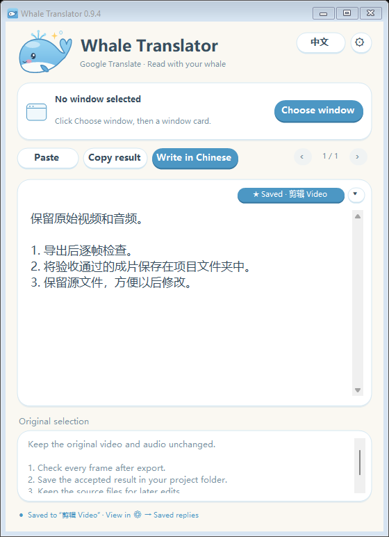
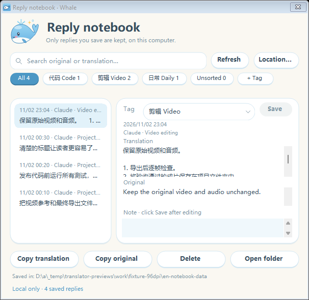
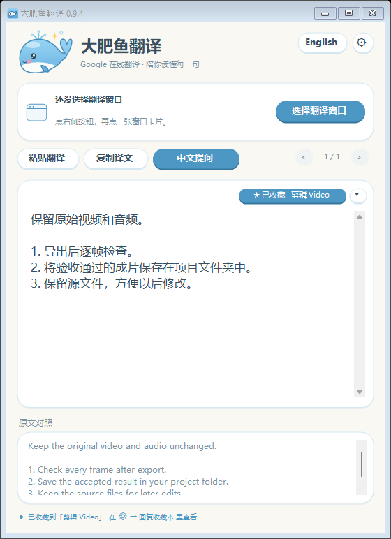
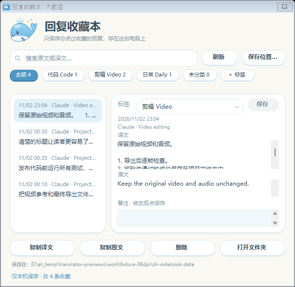

# Whale Translator 0.9.6

Translate selected Claude text, keep preferred terms, and explicitly save useful replies as local Markdown. Windows 10/11 x64 and .NET Framework 4.8 are required for the portable EXE. The interface supports English / 中文.

The 0.9.6 release EXE is **29.15 MB (29,146,112 bytes)**, below 30 MB. Optional offline language packs are separate downloads and use additional disk space.

## Select, translate, review

Open `WhaleTranslator.exe`, choose the source window from its cards, and select a target language. Drag to select text in that window and release the mouse to translate it. Selections elsewhere are ignored. You can pause selection translation or paste text manually; use **Write in Chinese** to review an English prompt before explicitly sending it.

Google mode uses a key-free web translation endpoint and may fail or rate-limit requests. For offline use, install the desired language direction while online. Offline mode stays local; **Use offline** retries with a compatible installed pack. Source detection, translation, sending and the existing bounded session history retain their workflows.

## 135 starter glossary entries

Open **⚙ → Glossary**. From 0.9.5 the initial dictionary includes 135 entries: names such as Claude, Codex, Hugging Face and GitHub Actions, common technical phrases, and Chinese → English terms for Write in Chinese. Names can stay unchanged across languages; phrases such as `context window` have a preferred Simplified Chinese translation, with selected reverse terms for English.

An existing saved dictionary is not replaced by an upgrade. Click **Add built-in terms** to fill nonconflicting gaps while retaining your translations, then click **Save**. The editor supports up to 200 entries. An explicitly saved empty dictionary remains empty until you choose to add terms again. Terms ignore case unless **Match case** is ticked; built-in names that are also everyday words (Skills, Sonnet, React, Rust…) keep it on. Dictionaries saved by 0.9.4 or earlier are upgraded when read: rows that differ only in case and share a translation become one row, and rows with different translations keep Match case. Longer phrases take priority, and code/URLs stay unchanged. Terms work in online and offline translation.

## Save only the replies you choose

1. Translate some text, then click **☆ Save** in the translation card. Without a successful translation, saving is unavailable. Nothing is automatically saved as a reply.
2. The button becomes **★ Saved · tag**. Its arrow lets you choose or create a tag; the last-used tag is the default. Clicking the saved button again unsaves the reply and removes its Markdown file.
3. Open **⚙ → Saved replies**. Search the original and translated text, filter tags, inspect details, copy either text, or edit the tag/note and click **Save**.

These images show the compiled 0.9.4 app rendered offscreen by Windows CI at 96 DPI (100%). Replies, tags and source titles are synthetic fixtures; the images do not establish real-machine interaction or 150% display-scale acceptance.

Each reply is one UTF-8 Markdown file, by default in the Windows **Documents\大肥鱼收藏** folder. The name starts with the save timestamp followed by a sanitized translation excerpt. Its contents include save time, source-window title, translation engine and language direction, tag, note, translation and original text.

Use **Location…** to choose a different local folder. Existing files are not moved automatically. **Open folder** opens the selected directory. **Refresh** rereads the files, including external edits/deletions; preserve the generated metadata and section markers when editing Markdown so the notebook can still recognize it. Invalid files are reported and left unchanged. Updating/deleting a file changed since the last read is blocked until you refresh.

The notebook's **Delete** button asks for confirmation and deletes that reply's Markdown file. Unsaving on the translation card also deletes its file. These actions do not send the file to the Recycle Bin. Keep your own backup if you need to retain it.

## What is kept locally

- Ordinary session history retains at most 20 successful translations / 256,000 characters in memory and clears when the app closes. It is not automatically archived.
- Only **explicitly saved replies** persist as Markdown in the chosen folder. The notebook makes no network requests and has no separate content index or content log.
- Preferences, the glossary and `favorites-settings.json` live under `%LOCALAPPDATA%\DafeiyuTranslator`. The favorites settings contain only folder/tag choices, not reply text.
- A cloud-sync service configured for the selected folder may synchronize files independently. Google translation, language-pack downloads and manual update checks have their own network behavior; see the [privacy notice](../../docs/PRIVACY.md).

## Build and verification

Use `build.ps1` for the Windows C# 5 desktop components. `packaging/build-portable.ps1` assembles the single EXE with its runtime. Tests cover glossary/history, notebook save/load/search/tags/filenames, UI behavior and existing translation workflows. They use generated fixtures; publishing requires successful CI and release-asset verification, not just a version label. See [building](../../docs/BUILDING.md) and [release notes](../../RELEASE_NOTES.md).

The public files remain **unsigned previews** until production signing is available; check [the signing policy](../../docs/CODE_SIGNING.md) and the release's SHA-256 values before running a download.

## 中文说明

**大肥鱼翻译 0.9.6** 保留选择窗口、松手翻译、中文提问和离线包流程，提供主动保存的「回复收藏本」和 **135 条内置术语**（产品名称、技术词组和中译英词条，默认不区分大小写）。

本版 EXE 为 **29.15 MB（29,146,112 字节）**，小于 30 MB；选装离线语言包需另外下载并占用空间。

**术语：** 打开 ⚙ → 术语词典 →「补充内置词条」，保留用户原译法并补齐未冲突的词，点「保存」后生效；升级不覆盖已有词典。最多保存 200 条。在线和离线都适用；从 0.9.5 起默认不区分大小写，勾选「区分大小写」的词条只认原样写法（Skills、Sonnet、Rust 等内置名称默认勾选）。长词组优先，代码与链接保持原样。

**收藏：** 有译文后主动点「☆ 收藏」，小箭头选择或新建标签，默认沿用上次标签。⚙ →「回复收藏本」可以搜索原文与译文、按标签筛选、修改标签和备注后保存、复制文字或打开文件夹。只有用户点击收藏才会保存，不自动归档聊天。

图片来自 Windows CI 对实际编译的 0.9.4 程序进行的 96 DPI（100%）离屏渲染。回复、标签与来源标题均为合成测试示例，不代表用户电脑上的交互或 150% 系统缩放验收。

默认一条一个 Markdown 文件，保存在**文档\大肥鱼收藏**，包含保存时间、来源窗口、翻译方式和语言、标签、备注、译文和原文。文件名用时间与清理后的译文片段。点「保存位置…」可改本机目录，旧文件不会自动搬家。手动改了或删了文件后点「刷新」，以文件为准；编辑 Markdown 时应保留生成的元数据和段落标记。无法解析的文件会提示并保留，外部改动会阻止过时的覆盖/删除。

收藏本「删除」会先确认；译文卡片再次点击「★ 已收藏」也会取消收藏。两者都删除对应 Markdown 文件，**不移入回收站**。本次翻译历史仍只在内存，关闭即清空；收藏另存本机文件，收藏本自身不联网，也不自动发给 Claude。目录若被其他服务同步，由该服务设置决定。

公开文件仍是未签名预览版。功能和附件需经构建、测试、发布后重新下载核验；版本号本身不代表验证通过。
